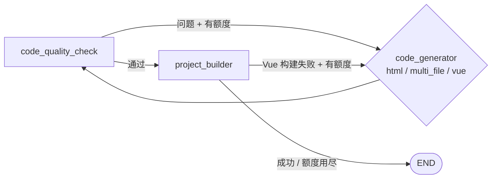

# 代码质检与自动修复循环

本文对应需求：**在代码生成之后新增代码质检 Agent 节点，检查代码是否有异常、能否正常打包；
发现问题时回到网站生成 Agent，把错误列表和改进建议拼进提示词，让模型在现有代码基础上修复，
而不是从零重新生成。**

实现分为三层：确定性的项目代码拼接、可复现的静态检查、AI 结构化复核；三者合并成一个
`QualityCheckResult`，由工作流条件边决定“继续构建 / 返回生成节点修复 / 终止”。

> 相关代码：`workflow/node/CodeQualityCheckNode.java`、`workflow/tools/CodeBundleTool.java`、
> `workflow/support/CodeQualityChecks.java`、`workflow/ai/CodeQualityCheckService.java`、
> `workflow/CodeGenWorkflow.java`。

## 1. 为什么不是“再调一次 AI 让它自己看文件”

如果让质检 Agent 通过工具调用逐个读取文件，会产生多轮模型交互：每读一个文件就要一次
tool_calls + tool_result，不仅慢，还会把整份代码重复塞进上下文，token 成本随文件数线性增长。
因此这里沿用图片收集优化的思路：**先由后端把项目拼成一份稳定快照，再只调用一次 AI 做结构化复核**。

```text
生成目录
  -> CodeBundleTool 遍历、过滤、排序、截断、拼接
  -> CodeQualityChecks 静态检查（可复现）
  -> CodeQualityCheckService 一次性 AI 复核（结构化 JSON）
  -> QualityCheckResult
       ├─ 通过 -> 项目构建
       └─ 不通过且有额度 -> 对应生成节点（修复提示词）
```

## 2. 工作流中的循环边



- 质检节点位于三个生成节点的汇合处，三个模式共用同一个质检节点。
- 质检失败时，条件边按 `generationType` 回到对应的生成节点，复用原来的生成链路和保存目录。
- Vue 构建失败也视为“无法正常打包”，在额度允许时同样回到生成节点修复。
- `repairAttempts` 由质检节点和构建节点共同消耗，`max-repair-attempts` 是全局上限，
  避免模型与质检互相“踢皮球”导致无限循环。
- 额度用尽后写入阻断性错误，工作流仍在 END 正常结束，调用方可以从结果中拿到错误列表。

## 3. 代码拼接工具（CodeBundleTool）

### 3.1 读取规则

| 规则 | 说明 |
| --- | --- |
| 目录范围 | 必须是 `tmp/code_output/{type}_{appId}`，再次校验路径前缀，防止读到任意目录 |
| 跳过目录 | `node_modules`、`dist`、`build`、`target`、`.git`、`.idea`、`.vscode`、`coverage`、`logs` 及隐藏目录 |
| 文件类型 | 只读取文本代码：html/css/js/ts/vue/jsx/tsx/json/yml/md 等，不读图片、字体等二进制 |
| 空文件 | 除 `index.html` 外跳过空文件；空 `index.html` 保留，用于报告“页面会白屏” |
| 排序 | 按相对路径排序，保证同一项目每次拼接结果稳定，便于复现和缓存 |
| 上限 | 文件数 `max-files`、单文件 `max-file-chars`、总量 `max-total-chars`，超限截断并标记 |
| 文本结构 | 顶部输出文件清单，之后每个文件以 `### 文件: 相对路径` 分段 |

工具返回 `ProjectCode`：既保留逐文件内容（静态检查和问题定位使用），也保留拼接文本
（AI 复核和修复提示词使用）。快照只存在于一次节点执行内，不进入工作流上下文，避免状态膨胀。

## 4. 静态检查（CodeQualityChecks）

静态检查只报告**确定会导致报错、白屏、构建失败或资源加载失败**的问题：

1. **完整性**：缺少 `index.html`、`index.html` 为空、缺少 `</html>`（典型截断）、
   文件中残留 Markdown 代码围栏（```）。
2. **本地资源引用**（HTML / 多文件）：`src`、`href`、CSS `url(...)` 指向的本地文件是否存在；
   跳过 `#锚点`、`https://`、`//cdn`、`data:`、模板变量等非本地引用。
3. **Vue 工程结构**：`package.json` 能否解析、是否有 `scripts.build`、是否声明 `vue` 依赖；
   是否存在 `src/main.js`（或 `main.ts`）；使用 `@/` 别名时是否配置了 Vite。
4. **模块导入**：扫描 `import ... from`、`import()`、`require()`，解析 `./`、`../`、`@/`
   路径，支持省略扩展名与目录 `index` 文件；找不到目标文件即报错。

静态问题一票否决：即使 AI 说通过，只要静态检查发现确定性问题，质检结果仍为不通过。
这可以挡住模型最常见的“只说没问题、代码其实被截断”的情况。

## 5. AI 结构化复核

### 5.1 输入

一次请求包含：生成模式、用户原始需求（截断）、静态检查结果、项目文件清单和拼接后的代码。
提示词明确：用户需求只用于理解意图，**只有代码本身确定报错/白屏/构建失败才计入 errors**，
样式、文案、性能等放入 suggestions。

### 5.2 输出

`CodeQualityCheckService` 返回 `QualityCheckReview`：

```json
{
  "valid": false,
  "errors": [
    "src/main.js：import App from './App.vue'，但工程中不存在 src/App.vue",
    "index.html：缺少 </html> 结束标签，文件疑似被截断"
  ],
  "suggestions": [
    "首屏图片建议增加 loading=\"lazy\""
  ]
}
```

错误会被清洗（去控制字符、压缩空白、限制 300 字符），与静态错误合并、去重，
最多保留 `max-errors` 条，并在截断时追加“仅保留前 N 条”。

### 5.3 降级

模型超时、限流、返回非法 JSON 时，节点记录告警并**降级为仅静态检查**，
不让模型故障阻断整个网站生成。结果中的 `source` 会标记为 `static`。

## 6. 修复提示词

修复轮次使用 `CodeQualityPromptSupport.buildRepairPrompt`，在原提示词后追加：

```text
## 本次任务：修复已有代码（不是重新生成）
当前项目已经生成过一版代码，必须在这一版代码基础上修复……

## 质检发现的问题（必须全部修复）
- ...

## 改进建议（尽量采纳，但不要为此破坏现有功能）
- ...

## 打包/构建失败信息（必须修复）
Vue 工程构建失败：npm install 或 npm run build 未通过……

## 当前代码（只读参考，必须在此基础上修改）   # 仅 HTML / 多文件模式
### 文件: index.html
...

## 修复要求
1. 只修改与问题相关的文件……
2. 必须输出完整文件，不能只输出差异片段……
```

- **Vue 工程模式**：不重复贴代码，要求先 `readDir` / `readFile` 了解现状，再用 `modifyFile`
  局部修改，必要时 `writeFile` 整文件重写；禁止重建整个工程。
- **HTML / 多文件模式**：把当前代码作为只读参考放进提示词，并强制输出完整文件，
  保证修复结果是“改过的完整版本”，而不是新的片段。
- 构建失败信息在拼进提示词后被清空，避免后续轮次重复携带已过期的错误。

## 7. 上下文与对外结果

`WorkflowContext` 新增：

| 字段 | 说明 |
| --- | --- |
| `qualityCheckResult` | 最近一次质检结果（是否通过、错误、建议、检查文件、耗时、是否截断） |
| `repairAttempts` | 已经消耗的修复次数，质检和构建失败共用 |
| `buildFailureMessage` | 允许继续修复时记录的构建失败原因；用于修复提示词 |

`WorkflowResult` / SSE 增加：

- `qualityCheck`：`valid`、`errors`、`suggestions`、`checkedFiles`、`checkedChars`、
  `truncated`、`source`、`durationMs`，不包含代码正文和服务器绝对路径；
- `repairAttempts`：自动修复轮数。

SSE 的 `node_completed` 事件中，质检节点展示“代码质检通过（N 个文件）”或
“代码质检未通过（M 个问题）”；循环轮次按实际节点执行顺序递增 `step`。

## 8. 配置

```yaml
app:
  workflow:
    quality-check:
      enabled: true            # 关闭后不做 AI 复核和修复循环
      max-repair-attempts: 2   # 质检/构建失败共用的修复上限
      max-files: 200
      max-file-chars: 30000
      max-total-chars: 80000
      max-repair-code-chars: 60000
      max-errors: 20
      max-suggestions: 10
      max-prompt-chars: 4000
```

对应环境变量：`WORKFLOW_QUALITY_CHECK_ENABLED`、`WORKFLOW_QUALITY_MAX_REPAIR_ATTEMPTS`、
`WORKFLOW_QUALITY_MAX_FILES`、`WORKFLOW_QUALITY_MAX_FILE_CHARS`、
`WORKFLOW_QUALITY_MAX_TOTAL_CHARS`、`WORKFLOW_QUALITY_MAX_REPAIR_CODE_CHARS`、
`WORKFLOW_QUALITY_MAX_ERRORS`、`WORKFLOW_QUALITY_MAX_SUGGESTIONS`、
`WORKFLOW_QUALITY_MAX_PROMPT_CHARS`。

## 9. 安全与成本

- **路径安全**：只读取 `tmp/code_output` 下的应用目录，拒绝 `..` 逃逸和任意目录。
- **提示词注入**：错误和建议都来自模型输出，进入下一轮提示词前会压缩空白、去控制字符、
  截断长度；代码文本只作为“只读参考”放在固定标题下。
- **成本控制**：一次质检最多一次模型调用；文件数、单文件、总字符都有上限；
  修复次数有全局上限，最坏情况是 1 + `max-repair-attempts` 轮生成和质检。
- **失败不放大**：AI 复核失败降级为静态检查；单次质检异常不会让整个工作流抛异常。

## 10. 测试

```powershell
mvn "-Dtest=CodeGenWorkflowTest,CodeQualityCheckNodeTest,CodeBundleToolTest,CodeQualityChecksTest,CodeQualityCheckServiceTest,ProjectBuilderNodeTest,HtmlCodeGeneratorNodeTest,WorkflowContextSerializerTest,WorkflowEventMapperTest,CodeGenPromptContractTest" test
```

覆盖点：

- 拼接工具过滤依赖/构建产物、排序、空文件、文件数/字符数截断、非法目录；
- 静态检查：缺失/截断入口、代码围栏、本地资源、Vue 构建必需文件、`@` 别名、模块导入、
  外部引用忽略、错误条数裁剪；
- 节点：通过、质检失败请求修复、额度耗尽阻断、静态错误压过 AI 结论、AI 失败降级、
  上游失败跳过、关闭开关、空目录；
- 完整图：三模式路由、质检失败后修复并成功、额度耗尽终止、Vue 构建失败后修复并成功、
  关闭质检仍能构建、编译图复用、SSE 结果字段；
- 修复提示词：包含错误、建议、构建错误、现有代码和“必须输出完整文件”约束；
- 结构化输出：JSON 到 `QualityCheckReview` 的映射。

## 11. 已知边界

1. AI 复核仍可能漏判；确定性问题主要靠静态检查兜底，两者是互补关系。
2. 代码超过字符上限时会截断检查，结果中的 `truncated=true` 提示检查不完整。
3. 修复轮次有限，模型连续无法修复时工作流会以可读错误结束，不会无限重试。
4. 静态检查只覆盖“确定性问题”，不做完整编译；真实打包结果仍以项目构建节点为准。
5. 质检通过后 Vue 构建仍可能因依赖安装、网络或环境问题失败，这类环境错误会被记录并
   在额度内交给模型修复，但无法保证一定修复成功。
