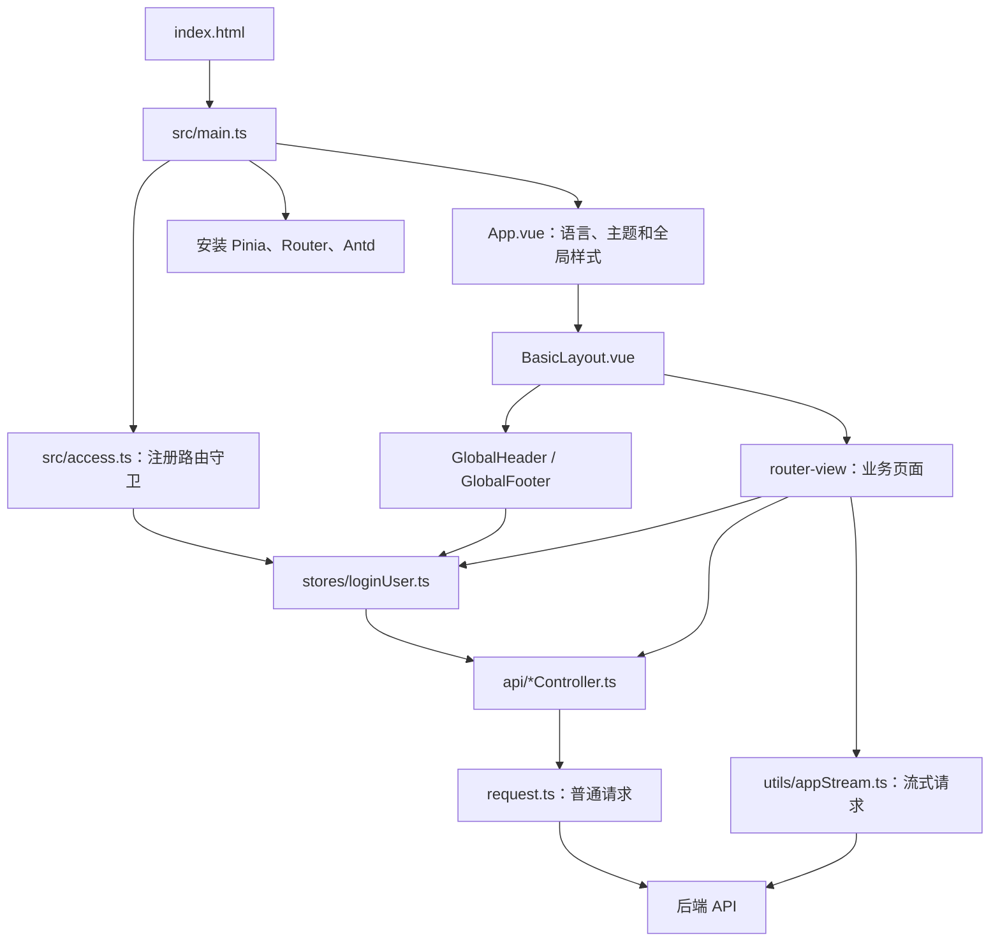
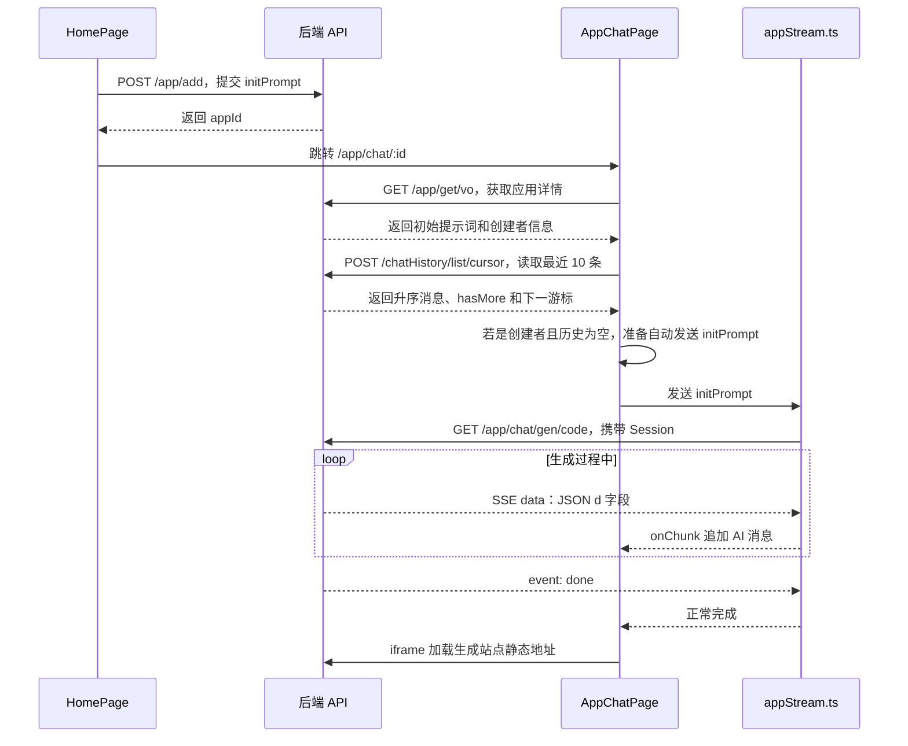

# 项目结构说明

本文梳理 `zgq-ai-code-mother-frontend` 前端工程的目录、模块职责、调用关系和维护入口，依据当前代码整理。后端通过 HTTP 接口提供登录、应用管理、AI 生成和静态站点服务。

## 1. 技术栈

| 技术                        | 项目中的用途                                        |
| --------------------------- | --------------------------------------------------- |
| Vue 3 + TypeScript          | 页面与组件开发，主要采用 `<script setup lang="ts">` |
| Vite 7                      | 本地开发服务、模块解析和生产构建                    |
| Vue Router 4                | 页面路由、导航守卫、路由懒加载                      |
| Pinia 3                     | 全局登录用户状态                                    |
| Ant Design Vue 4            | 表单、表格、分页、弹窗及反馈组件                    |
| Axios                       | 普通 HTTP 请求和统一响应拦截                        |
| Fetch + ReadableStream      | SSE 流式生成、取消请求和已有预览探测                |
| Day.js                      | 应用与用户时间展示                                  |
| `@umijs/openapi`            | 根据后端 OpenAPI 文档生成请求函数和类型             |
| ESLint + Prettier + vue-tsc | 代码规范、格式化及类型检查                          |

## 2. 目录总览

```text
zgq-ai-code-mother-frontend/
├─ docs/
│  └─ 项目结构说明.md              # 当前文档
├─ public/
│  └─ bitbug_favicon.ico           # 按原路径提供的静态资源
├─ scripts/
│  ├─ generate-api.mjs             # 校验 OpenAPI 文档并生成 src/api
│  ├─ test-app-stream.mjs          # SSE 协议及取消行为的自动化测试
│  └─ test-visual-editor.mjs       # 可视化编辑元素信息、提示词和注入脚本测试
├─ src/
│  ├─ access/
│  │  ├─ accessEnum.ts             # notLogin、user、admin 权限常量
│  │  └─ checkAccess.ts            # 权限判断，供顶部菜单过滤使用
│  ├─ api/                        # OpenAPI 生成的请求与类型
│  │  ├─ appController.ts          # 应用创建、查询、修改、删除、部署等接口
│  │  ├─ chatHistoryController.ts  # 应用游标历史与管理员全局历史查询
│  │  ├─ userController.ts         # 登录、注册、用户查询与管理接口
│  │  ├─ staticResourceController.ts # 生成站点静态资源接口
│  │  ├─ healthController.ts       # 后端健康检查接口
│  │  ├─ index.ts                  # 按控制器聚合导出
│  │  └─ typings.d.ts              # 全局 API 命名空间和数据类型
│  ├─ assets/
│  │  └─ rocket.png                # 顶部导航使用的品牌图片
│  ├─ components/
│  │  ├─ AppCard.vue               # 应用卡片、封面、详情入口、编辑与删除
│  │  ├─ AppDetailDescriptions.vue # 首页和工作台共用的应用详情字段
│  │  ├─ AuthFormLayout.vue         # 登录和注册表单共用布局
│  │  ├─ GlobalHeader.vue          # 导航菜单、用户信息、登录与退出
│  │  ├─ GlobalFooter.vue          # 公共页脚
│  │  └─ MarkdownContent.vue       # 生成内容的 Markdown 和代码高亮展示
│  ├─ config/
│  │  └─ index.ts                  # API_BASE_URL 统一配置
│  ├─ layouts/
│  │  └─ BasicLayout.vue           # 公共布局、首页宽度和全屏工作台布局
│  ├─ pages/
│  │  ├─ admin/
│  │  │  ├─ AppManagePage.vue      # 管理员应用管理
│  │  │  ├─ ChatHistoryManagePage.vue # 管理员对话管理
│  │  │  └─ UserManagePage.vue     # 管理员用户管理
│  │  ├─ app/
│  │  │  ├─ AppChatPage.vue        # AI 对话、生成预览和部署工作台
│  │  │  └─ AppEditPage.vue        # 本人或管理员编辑应用信息
│  │  ├─ user/
│  │  │  ├─ UserLoginPage.vue      # 用户登录和登录后跳转
│  │  │  └─ UserRegisterPage.vue   # 用户注册
│  │  ├─ HomePage.vue             # 提示词创建、我的应用和精选应用
│  │  └─ NotFoundPage.vue         # 未匹配路由的 404 页面
│  ├─ router/
│  │  └─ index.ts                 # 路由表及页面权限元信息
│  ├─ stores/
│  │  ├─ loginUser.ts             # 登录用户状态和获取登录用户的方法
│  ├─ utils/
│  │  ├─ app.ts                   # ID 比较/校验、预览 URL、时间与错误处理
│  │  ├─ appStream.ts             # SSE 请求、事件解析、完成和取消处理
│  │  └─ visualEditor.ts          # 可视化编辑：iframe 注入、元素采集、postMessage 与提示词拼接
│  ├─ access.ts                   # 当前实际注册的全局路由权限守卫
│  ├─ request.ts                  # Axios 实例及未登录响应处理
│  ├─ App.vue                     # 根组件、中文组件语言包、主题与全局样式
│  └─ main.ts                     # 创建 Vue 应用并安装 Pinia、Router 和 Antd
├─ .env.development                # 本地开发环境变量：相对 /api，配合 Vite 代理保持同源
├─ .env.production                 # 生产构建环境变量：同源 /api，由 Nginx 转发到后端
├─ .env.example                   # API、预览和代理地址环境变量示例
├─ .editorconfig                  # 编辑器基础格式约定
├─ .prettierrc.json               # Prettier 格式约定
├─ eslint.config.ts               # ESLint 配置
├─ env.d.ts                       # Vite 客户端类型声明
├─ index.html                     # HTML 入口，挂载节点为 #app
├─ openapi2ts.config.ts            # OpenAPI 文档地址和生成路径配置
├─ package.json                   # 项目依赖和 npm 命令
├─ package-lock.json              # npm 依赖锁文件
├─ tsconfig.json                  # TypeScript 项目引用入口
├─ tsconfig.app.json              # 前端源码类型检查与 @ 路径映射
├─ tsconfig.node.json             # 构建工具和配置文件类型检查
├─ vite.config.ts                 # Vue 插件、@ 别名和 /api 开发代理
├─ default.md                     # 已提供的后端接口文档快照
└─ README.md                      # 环境准备、启动与联调说明
```

`node_modules/` 为安装的依赖，`dist/` 为构建产物，均由工具生成并被 Git 忽略。`.env.development` 保存本地开发默认值，可在 `.env.local` 中覆盖；`.env.local` 被当前忽略规则排除。源码中的 `@/` 指向 `src/`。

## 3. 启动与模块调用关系



首次导航时，`src/access.ts` 等待获取登录用户，再根据路由的 `meta.access` 判断是否允许进入。未登录访问受保护页面时跳到登录页，并通过 `redirect` 保存目标地址；登录成功后返回允许的站内路径。

`BasicLayout.vue` 根据路由元信息调整布局。普通页面显示公共导航和页脚，首页使用通栏背景；对话页设置 `meta.fullscreen = true`，隐藏公共导航和页脚，由工作台自行显示顶部栏。

## 4. 页面路由与权限

| 路径                       | 页面文件                                    | 访问条件与职责                                           |
| -------------------------- | ------------------------------------------- | -------------------------------------------------------- |
| `/`                        | `src/pages/HomePage.vue`                    | 游客可进入；创建、我的应用列表和精选列表需要登录         |
| `/user/login`              | `src/pages/user/UserLoginPage.vue`          | 登录、更新全局用户信息、处理登录后跳转                   |
| `/user/register`           | `src/pages/user/UserRegisterPage.vue`       | 注册并跳转登录页，保留原目标地址                         |
| `/app/chat/:id`            | `src/pages/app/AppChatPage.vue`             | 登录用户可查看应用；仅创建者可生成、可视化编辑元素和部署 |
| `/app/edit/:id`            | `src/pages/app/AppEditPage.vue`             | 创建者修改名称；管理员可修改任意应用的名称、封面和优先级 |
| `/admin/appManage`         | `src/pages/admin/AppManagePage.vue`         | 管理员查询、查看、编辑、删除和设置精选                   |
| `/admin/chatHistoryManage` | `src/pages/admin/ChatHistoryManagePage.vue` | 管理员跨应用筛选、分页查询用户与 AI 消息                 |
| `/admin/userManage`        | `src/pages/admin/UserManagePage.vue`        | 管理员查询和删除用户                                     |
| `/:pathMatch(.*)*`         | `src/pages/NotFoundPage.vue`                | 未匹配地址显示 404 页面                                  |

权限由三个位置配合完成：`router/index.ts` 声明页面所需角色，`access.ts` 拦截路由访问，页面根据应用的 `userId` 判断资源归属。后端仍是接口权限校验的最终依据，管理员也不能通过前端对他人应用发起生成或部署。

顶部菜单由 `GlobalHeader.vue` 的 `originItems` 明确配置，再结合路由权限和 `hideInMenu` 过滤。新增路由不会自动出现在导航菜单中。

## 5. 主要业务模块

### 5.1 主页与应用卡片

`HomePage.vue` 管理提示词、创建状态、详情弹窗，以及“我的应用”和“精选应用”两套独立的搜索和分页状态。默认每页 6 条，可选 6、12、20 条；普通用户列表请求最多 20 条。

提示词草稿使用 `sessionStorage` 的 `app-create-prompt` 保存，便于登录跳转后恢复。创建成功会清空草稿，并进入 `/app/chat/{id}`，不再依赖 URL 查询参数触发首次生成。

`AppCard.vue` 负责单个应用的展示，通过事件将详情和删除交给主页处理。没有封面时使用样式占位；卡片通过路由进入对话页，不会批量加载应用预览 iframe。

### 5.2 AI 对话与网站预览



对话页不使用生成目录中的 `chatToGenCode()` 来读取实时内容，而是调用 `utils/appStream.ts` 的 `generateAppCode()`。该工具通过 Fetch 逐片读取 SSE，并处理 UTF-8 拆包、JSON 解析、业务错误和中止请求。

首次进入时只有“创建者且历史为空”才自动发送 `initPrompt`；否则直接展示已加载历史，并在至少有 2 条记录时探测并展示已生成的网站。

后端的数据事件内容为 `{"d":"一段回复"}`，正常结束事件为 `event: done`。仅收到网络 EOF 不算生成成功；断流或主动停止时不会更新生成预览。页面切换或卸载时会中止相关请求，并避免过期响应写入新的页面状态。

预览地址由 `getAppPreviewUrl()` 构造：

```text
{APP_PREVIEW_BASE_URL}/static/{codeGenType}_{appId}/
```

已有应用打开时会通过 HEAD 请求检查是否存在 HTML 预览；当前会话发起生成后，需等待完成事件才显示新结果。生成站点由后端提供，并通过带 sandbox 的 iframe 展示，不属于前端 Vite 的构建产物。

#### 可视化编辑模式

发送按钮左侧的“编辑元素”按钮用于进入可视化编辑。相关逻辑独立在 `src/utils/visualEditor.ts`，页面只保存状态并调用三个入口：

| 函数 | 作用 |
| --- | --- |
| `mountVisualEditor(iframe, onSelected)` | 校验同源并取得 `contentDocument`，注入样式和元素采集脚本，监听子页面 `postMessage`，返回清理函数 |
| `composePromptWithElement(prompt, element)` | 把选中元素信息块追加到用户提示词，没有元素时原样返回 |
| `describeSelectedElement(element)` | 生成 Alert 中的紧凑描述，例如 `button#submit.btn.primary` |
| `clearVisualEditorSelection(iframe)` | 清除 iframe 中的选中边框，Alert 点击“移除”时调用 |

交互流程：

1. 进入编辑模式后，注入脚本给 `<html>` 加编辑标记，所有元素显示十字光标；鼠标悬浮元素添加 `data-ai-code-mother-hover`，显示虚线边框。
2. 点击元素时脚本阻止默认跳转和事件冒泡，添加 `data-ai-code-mother-selected` 显示固定实线边框，并通过 `window.parent.postMessage` 发送 `{ type, element }`。
3. 父页面校验 `event.source`、`event.origin` 和数据结构后，把元素保存到 `selectedElement`，在输入框上方显示 `a-alert`。
4. 发送消息时把元素信息合并进提示词；发送后清空选中元素、退出编辑模式，并重新走原有 SSE 生成流程。
5. iframe 刷新或重建后，如果仍在编辑模式，`@load` 会重新注入；退出编辑或页面卸载时移除监听、样式、脚本和选中属性。

因为需要访问同源 iframe 的 `contentDocument`，预览站点必须与前端同源。本地依赖 `.env.development` 的 `/api` 和 Vite 代理，线上依赖 Nginx。跨域时页面会给出可读告警而不是静默失败。完整协议和安全边界见后端仓库的 `docs/visual-editing.md`。

### 5.3 部署

创建者在预览就绪且没有生成请求进行时，可调用 `POST /app/deploy`。页面展示后端返回的 HTTP/HTTPS 地址，支持复制链接和新窗口访问，并尝试刷新应用部署信息。

部署地址由后端决定，不能直接使用预览地址替代。实际部署文件和对外域名服务由后端及运行环境负责。

### 5.4 管理与编辑

`AppManagePage.vue` 使用搜索表单和分页表格，支持 ID、名称、用户 ID、封面、初始提示词、生成类型、部署标识、优先级和删除状态等筛选，以及排序和自定义每页数量。管理员分页没有普通用户的 20 条限制。

管理页的编辑操作打开新窗口；精选操作提交 `priority: 99`；删除操作需要确认，后端会在同一事务内逻辑删除应用及其对话历史。已删除记录可查看列表中的只读快照，变更操作会被禁用。

`AppEditPage.vue` 根据身份选择详情和保存接口。普通用户仅提交应用 ID 和名称；管理员提交应用 ID、名称、封面和优先级。页面校验名称最多 256 个字符、封面地址最多 1024 个字符，以及优先级的整数范围。

### 5.5 对话管理与管理员查询

`AppChatPage.vue` 首次进入时调用 `/chatHistory/list/cursor` 读取最新 10 条消息，按创建时间升序展示；使用响应中的 `nextCursorCreateTime` 与 `nextCursorId` 可继续加载更多历史。只有应用创建者且历史为空时，才自动用 `initPrompt` 发起第一条消息；已有至少 2 条历史记录时会探测并展示已生成的网站。用户消息和 AI 最终回复由后端在生成流订阅、完成或失败时保存。

`ChatHistoryManagePage.vue` 提供管理员全局查询，可按应用 ID、用户 ID 和消息类型筛选，表格展示消息预览，详情弹窗展示完整内容，并可跳转打开所属应用。应用管理页的“对话”按钮会携带 `appId` 查询参数进入该页并自动筛选。

## 6. 接口、状态与配置

### 6.1 普通请求和生成代码边界

`src/api/` 中的请求函数复用 `src/request.ts`，返回 Axios 响应对象。后端业务结果位于 `res.data`，实际业务数据位于 `res.data.data`，页面仍需判断业务 `code`。

| 模块               | 主要接口                                                           | 调用位置                                 |
| ------------------ | ------------------------------------------------------------------ | ---------------------------------------- |
| 用户               | `/user/login`、`/user/register`、`/user/get/login`、`/user/logout` | 登录/注册页、登录用户 Store、全局导航    |
| 应用创建与个人列表 | `/app/add`、`/app/my/list/page/vo`、`/app/good/list/page/vo`       | 主页                                     |
| 应用详情           | `/app/get/vo`、管理员专用 `/app/get`                               | 主页详情、对话页、编辑页、管理页         |
| 应用修改与删除     | `/app/update`、`/app/admin/update`、`/app/delete`                  | 编辑页、主页、管理页                     |
| 管理员应用查询     | `/app/list/page`                                                   | 应用管理页                               |
| 对话历史           | `/chatHistory/list/cursor`、`/chatHistory/admin/list/page`         | 对话页、对话管理页                       |
| SSE 生成           | `/app/chat/gen/code`                                               | `AppChatPage.vue` → `utils/appStream.ts` |
| 部署与预览         | `/app/deploy`、`/static/{codeGenType}_{appId}/`                    | 对话页                                   |

`scripts/generate-api.mjs` 从 `openapi2ts.config.ts` 读取文档地址，校验 OpenAPI 格式和必要用户接口，然后生成请求代码。脚本会规范 Spring 的 `{*resourcePath}` 通配路径，避免生成非法的 TypeScript 路径表达式。

重新生成会覆盖 `src/api/` 中的文件，因此自定义业务逻辑放在页面、Store 或工具模块中。`default.md` 是接口文档快照，执行生成命令时实际读取的是配置中的在线 OpenAPI JSON。

### 6.2 状态与数据约定

| 数据                 | 保存位置                     | 当前行为                                                          |
| -------------------- | ---------------------------- | ----------------------------------------------------------------- |
| 登录用户             | `stores/loginUser.ts`        | Pinia 内存状态，刷新后通过接口重新获取                            |
| 登录会话             | 后端 Session / 浏览器 Cookie | Axios 使用 `withCredentials`，Fetch 使用 `credentials: 'include'` |
| 首页提示词草稿       | `sessionStorage`             | 使用 `app-create-prompt` 键，创建成功后清除                       |
| 列表搜索、分页和弹窗 | 各页面的 `ref` / `reactive`  | 由对应页面管理                                                    |
| 当前对话消息         | `AppChatPage.vue` 内存状态   | 打开应用时从后端加载，生成过程中追加；刷新后可重新读取            |
| 应用与用户 ID        | 后端返回的原始值             | Long 字符串不转 Number，避免雪花 ID 丢失精度                      |
| 分页总数 `totalRow`  | 页面转换后的数值             | 列表将后端可能返回的字符串计数转为 Number                         |

生成类型中部分 ID 声明为 `number`，运行时可能是字符串。相关页面使用类型断言保留原值，不能把类型断言替换为 `Number(id)`。

### 6.3 配置入口

| 要调整的内容                      | 配置或代码位置                                                       |
| --------------------------------- | -------------------------------------------------------------------- |
| REST 和 SSE 的 API 根地址         | `.env.development` / `.env.local` 的 `VITE_API_BASE_URL`；默认值在 `src/config/index.ts` |
| 生成站点预览根地址                | `.env.local` 的 `VITE_APP_PREVIEW_BASE_URL`；未设置时沿用 API 根地址 |
| 本地 Vite 代理目标                | `.env.local` 的 `VITE_PROXY_TARGET`；默认 `http://localhost:8123`    |
| 生成请求代码时读取的 OpenAPI 地址 | `openapi2ts.config.ts` 的 `schemaPath`                               |
| Axios 超时和未登录跳转            | `src/request.ts`，当前超时为 60 秒                                   |
| 路由、访问角色和全屏页面          | `src/router/index.ts`                                                |
| 顶部菜单项目                      | `src/components/GlobalHeader.vue`                                    |
| 全局主题、中文语言包与基础样式    | `src/App.vue`                                                        |
| Vite 插件、路径别名和代理          | `vite.config.ts`                                                     |

`.env.development` 把 API 根地址设为相对目录 `/api`，`vite.config.ts` 再把 `/api` 代理到 `http://localhost:8123`。前端请求、SSE 和 `/api/static` 预览资源都保持同源，登录 Cookie 可以正常携带，可视化编辑也能访问 iframe 的 `contentDocument`。生成预览地址为 `{APP_PREVIEW_BASE_URL}/static/{codeGenType}_{appId}/`，地址不要包含末尾斜杠。

线上应通过 Nginx 把 `/api` 转发到后端，并在构建前设置 `VITE_API_BASE_URL=/api`；不要把预览配置到独立域名，否则无法注入可视化编辑脚本。修改环境变量后应重启开发服务。

## 7. 开发、检查与维护入口

| 命令                       | 作用                                                |
| -------------------------- | --------------------------------------------------- |
| `npm ci`                   | 按锁文件安装依赖                                    |
| `npm run dev`              | 启动 Vite 开发服务                                  |
| `npm run openapi2ts`       | 从运行中的后端生成请求代码和类型                    |
| `npm run type-check`       | 使用 vue-tsc 检查 TypeScript 和 Vue 文件            |
| `npm run test:app-preview` | 检查独立预览域名及未配置时的 API 地址回退，无需后端 |
| `npm run test:stream`      | 执行 SSE 自动化测试，无需后端                       |
| `npm run test:visual-editor` | 执行可视化编辑元素信息、提示词和注入脚本测试        |
| `npm run build`            | 并行执行类型检查和生产构建，产物输出到 `dist/`      |
| `npm run build-only`       | 仅执行 Vite 生产构建                                |
| `npm run preview`          | 本地预览构建产物                                    |
| `npm run lint`             | ESLint 检查并自动修复                               |
| `npm run format`           | 使用 Prettier 格式化 `src/`                         |

SSE 测试位于 `scripts/test-app-stream.mjs`，使用模拟 Fetch 验证拆包、完成事件、错误、断流、中止和长 ID 等行为；可视化编辑测试位于 `scripts/test-visual-editor.mjs`，使用 esbuild 打包工具模块后验证元素信息、提示词拼接、消息校验和注入脚本。当前仓库没有配置可直接运行的浏览器端到端测试套件。对话历史的游标、参数校验和管理员查询由后端单元测试覆盖。

维护时优先按变更目标定位文件：页面交互放在 `pages/`，复用展示放在 `components/`，跨页面状态放在 `stores/`，协议处理和通用函数放在 `utils/`。新增受保护页面时，同时检查路由角色、菜单入口和页面资源归属判断。

当前权限守卫由 `src/access.ts` 负责，`main.ts` 会在启动时加载它。未被引用的重复守卫和 Pinia 计数器示例已移除。应用卡片、首页与工作台的应用详情字段，以及登录与注册表单布局均通过共享组件维护。

生产部署使用 Vue Router 的 History 模式，需要让前端服务器把页面路由回退到 `index.html`，保证直接访问或刷新 `/app/chat/:id` 等地址时可以加载页面。后端 API 和生成站点的静态资源仍由对应后端服务处理。

环境准备和详细启动步骤见 [README](../README.md)；接口字段快照见 [default.md](../default.md)。
